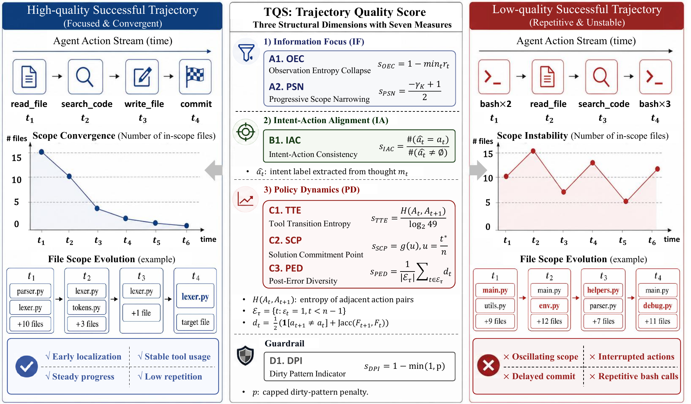
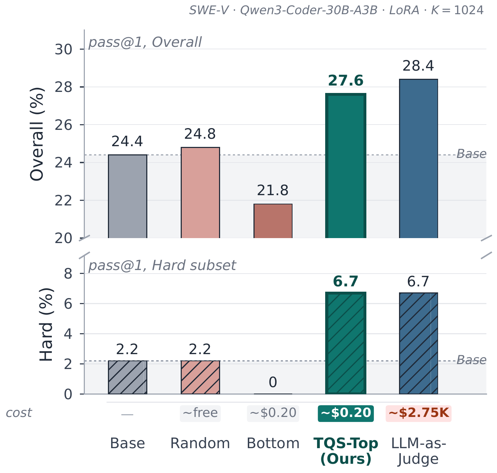
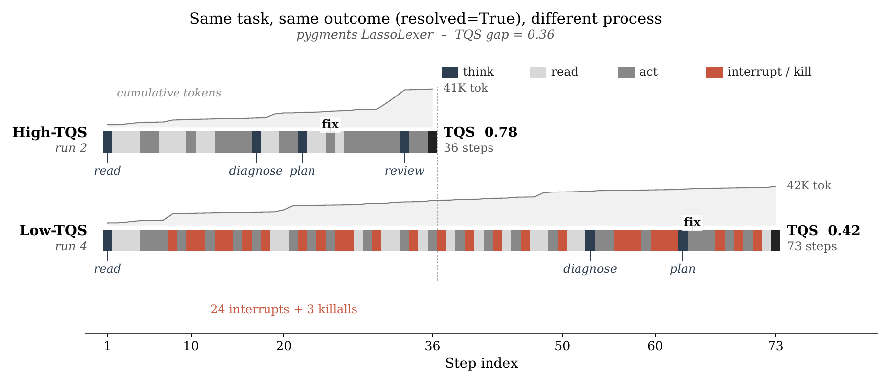

<div align="center">

# TQS

### Quality, Not Just Outcome
**A Structural Scoring Framework for Selecting Coding-Agent Trajectories for Supervised Fine-Tuning**

Sida Li · Yuanxin Liu · Shicheng Li · Linli Yao · Xu Sun · Haoli Bai · Xiao-Hui Li

**Findings of EMNLP 2026**

[](https://arxiv.org/abs/2610.13152)
[](https://2026.emnlp.org/)
[](https://www.python.org/)
[](LICENSE)

[Paper](https://arxiv.org/abs/2610.13152) · [Quick start](#quick-start) · [Results](#results) · [Scoring guide](docs/data-and-scoring.md) · [Citation](#citation)

</div>

TQS scores the **process behind a successful coding-agent run**: how observations become focused, whether actions follow the stated intent, and how the agent edits, tests, and recovers. It uses event logs without an LLM judge and combines seven structural measures into a score in [0, 1].

<p align="center">
  
</p>

## Highlights

- **Process-aware selection.** On SWE-bench Verified, Top-TQS training reaches **27.6%** pass@1, versus **24.8%** for random selection and **21.8%** for bottom selection.
- **Lightweight scoring.** The paper reports 43 ms per trajectory on one CPU worker; model training and sandbox execution are separate stages.
- **Seven interpretable signals.** Missing components are excluded and the remaining weights are renormalized.
- **A small starting point.** Score the included synthetic trajectory locally before preparing a corpus or setting up GPUs.

The paper and reported results follow [arXiv:2610.13152v1](https://arxiv.org/html/2610.13152v1), released on October 9, 2026.

## Quick start

Python 3.10 or newer is required. Scoring runs on CPU.

```bash
git clone https://github.com/DuHeng0128/TQS.git
cd TQS
python -m venv .venv
source .venv/bin/activate
python -m pip install -e .

python -m tqs \
  --input examples/trajectory.json \
  --output outputs/demo.jsonl
```

On Windows, activate the environment with `.venv\Scripts\Activate.ps1`. The example is synthetic and demonstrates the input schema; its score is not a paper result.

The output contains `tqs_score`, `tqs_coverage`, all seven `tqs_*` components, raw diagnostics, and a structural eligibility flag. Existing output files are not overwritten.

### Score your data

```bash
python -m tqs \
  --input /path/to/trajectory-shards \
  --format coderforge \
  --output outputs/scores.parquet \
  --workers 4
```

Input can be JSON, JSONL, parquet, or a directory. Supported formats are `coderforge`, message-based `openhands`, event-based `openhands_json`, and `swe_agent`; `auto` handles common schemas. See the [data and scoring guide](docs/data-and-scoring.md) for details.

### Prepare training data

The Top-TQS, Bottom-TQS, and Random training subsets are included in
[`data/`](data/README.md), with 1,024 trajectories each and matching ID manifests.
Convert a bundled subset and train:

```bash
python training/prepare_dataset.py \
  --source data/top.parquet \
  --ids training/splits/top.txt \
  --output outputs/data/top.jsonl

DATASET_PATH="$PWD/outputs/data/top.jsonl" bash training/train_lora.sh
```

See [`training/`](training/README.md) for the Qwen3-Coder-30B-A3B LoRA configuration.
Only these selected subsets are bundled; the full upstream corpus and model weights are not.

To select new subsets from your own scores:

```bash
python -m tqs.split \
  --scores outputs/scores.parquet \
  --source-dir /path/to/source-trajectory-shards \
  --output-dir outputs/subsets \
  --k 1024
```

This creates `top/`, `bottom/`, `random/`, and `split_summary.json`. Selection uses passing trajectories, at least three steps, coverage of at least 4/7, and an actual tokenized length of at most 32,768. Supply tokenizer-derived `total_tokens` in the score input; character-count estimates are reported separately and are not used as a substitute.

## How TQS works

| Dimension | Component | Weight | Structural signal |
| --- | --- | ---: | --- |
| Information focus | OEC | 0.30 | Observation entropy collapse |
| Information focus | PSN | 0.10 | Progressive scope narrowing |
| Intent–action alignment | IAC | 0.25 | Agreement between stated intent and tool action |
| Policy dynamics | TTE | 0.10 | Tool transition entropy |
| Policy dynamics | SCP | 0.05 | Timing of the first substantive edit |
| Policy dynamics | PED | 0.10 | Behavioral change after errors |
| Guardrail | DPI | 0.10 | Early stopping, no edit, loops, and repeated errors |

`compute_tqs` is also available as a Python API:

```python
from tqs import compute_tqs

# raw_metrics is the dict returned by the metric registry.
result = compute_tqs(raw_metrics)
print(result["tqs_score"], result["components"])
```

TQS evaluates observable interaction structure. It does not verify that a patch addresses the underlying bug, and its parsers may need adaptation for other agent scaffolds.

## Results

Paper Table 3, SWE-bench Verified pass@1 (%). Each SFT condition uses 1,024 trajectories with the same Qwen3-Coder-30B-A3B-Instruct backbone and training recipe.

| Selection | Easy | Medium | Hard | Overall |
| --- | ---: | ---: | ---: | ---: |
| Base, no SFT | 36.6 | 19.2 | 2.2 | 24.4 |
| Random | 40.7 | 16.9 | 2.2 | 24.8 |
| Bottom-TQS | 33.5 | 16.9 | 0.0 | 21.8 |
| Shortest | 37.6 | 18.4 | 0.0 | 24.2 |
| DPI only | 37.6 | 19.9 | 2.2 | 25.2 |
| LLM judge, GPT-4o | **43.3** | **21.1** | **6.7** | **28.4** |
| Top-TQS, length-matched | 40.7 | 20.7 | 4.4 | 27.0 |
| **Top-TQS** | 42.3 | 20.3 | **6.7** | **27.6** |

The LLM judge is 0.8 points higher overall; TQS offers a much cheaper selection stage. These are paper-reported, single-run SFT results, not measurements produced by the quick start.

<p align="center">
  
</p>

<details>
<summary><b>Same task and outcome, different processes</b></summary>

<p align="center">
  
</p>

Both runs pass the task. The paper's example contrasts a 36-step run scoring 0.78 with a 73-step run scoring 0.42.

</details>

## Repository guide

| Path | Purpose |
| --- | --- |
| [`tqs/`](tqs/) | Public scoring API, command-line tools, parsers, and metric implementations |
| [`examples/`](examples/) | Small synthetic input for CPU scoring |
| [`docs/data-and-scoring.md`](docs/data-and-scoring.md) | Schemas, token counts, component mapping, and selection |
| [`training/`](training/) | Selection manifests, agent-data conversion, and 30B-A3B LoRA training |
| [`data/`](data/README.md) | Top-TQS, Bottom-TQS, and Random training trajectories |
| [`evaluation/`](evaluation/) | OpenHands/Daytona runner, vLLM launchers, and SWE-bench verification |
| [`tests/`](tests/) | CPU regression checks for the scoring and selection interfaces |

## Citation

```bibtex
@article{li2026tqs,
  title   = {Quality, Not Just Outcome: A Structural Scoring Framework for Selecting Coding-Agent Trajectories for Supervised Fine-Tuning},
  author  = {Li, Sida and Liu, Yuanxin and Li, Shicheng and Yao, Linli and Sun, Xu and Bai, Haoli and Li, Xiaohui},
  journal = {arXiv preprint arXiv:2610.13152},
  year    = {2026},
  note    = {Accepted to Findings of EMNLP 2026},
  url     = {https://arxiv.org/abs/2610.13152}
}
```

## License and contact

Code is released under the [MIT License](LICENSE). Upstream datasets, model weights, and agent frameworks retain their own licenses. Paper figures are credited in [assets/README.md](assets/README.md).

For questions, open a [GitHub issue](https://github.com/DuHeng0128/TQS/issues) or contact [Sida Li](mailto:lisida@stu.pku.edu.cn).
